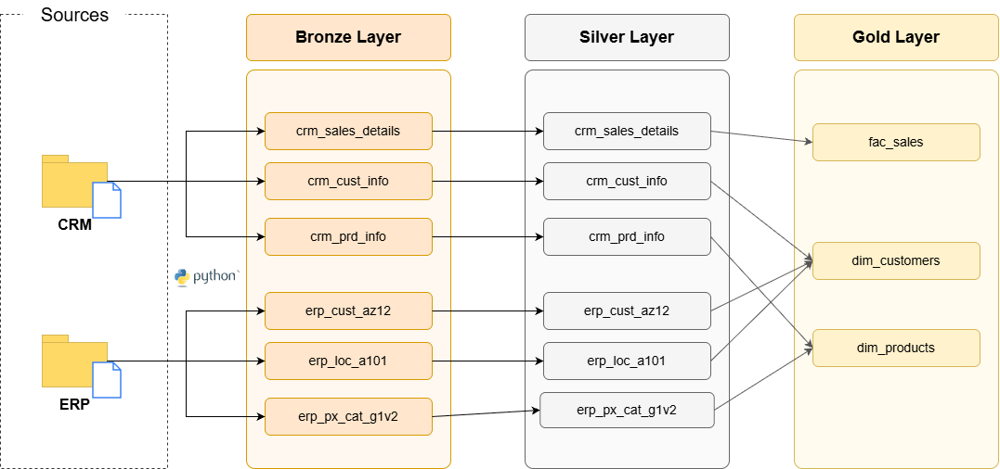
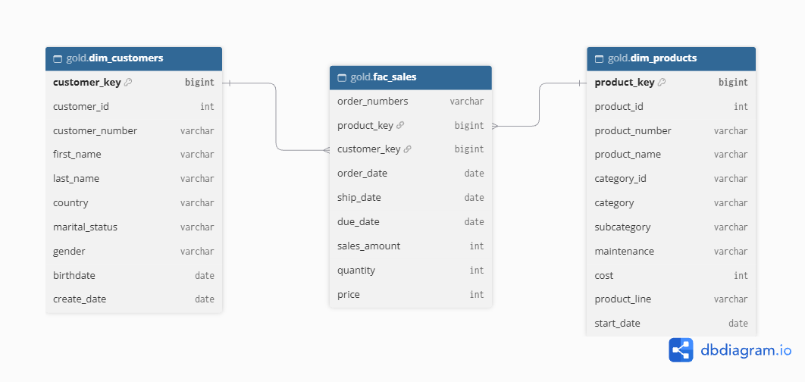

# Data Warehouse and Analytics Project — Databricks Edition

End-to-end data warehouse built on **Databricks** using the **Medallion Architecture** (Bronze, Silver, Gold). Raw CSV files from two source systems (CRM and ERP) are ingested with **PySpark**, cleansed and standardized with **SQL**, and modeled into a **star schema** ready for analytics. The full load is orchestrated by a **Databricks Job**, with error handling and execution logging.

> Based on the [SQL Data Warehouse Project](https://github.com/DataWithBaraa/sql-data-warehouse-project) by **Data With Baraa**. The original project uses SQL Server and stored procedures. This version re-implements it on Databricks, using the tools and patterns found in most modern data platforms: Unity Catalog, Delta Lake, PySpark, and Jobs orchestration.

---
## 🏗️ Data Architecture

<p align="center">

</p>

| Layer | Object Type | Load Strategy | Transformations |
|---|---|---|---|
| **Bronze** | Delta tables | Full load (overwrite) | None, raw data as-is from source |
| **Silver** | Delta tables | Full load (`INSERT OVERWRITE`) | Cleansing, standardization, normalization, derived columns |
| **Gold** | Views | Recreated on each run | Data integration, business logic, star schema |

**Catalog structure (Unity Catalog):**

```
dev_dw
├── bronze
│   ├── landing_files (volume)   -> source CSV files
│   └── crm_* / erp_* tables     -> raw data
├── silver
│   ├── crm_* / erp_* tables     -> cleansed data
│   └── etl_log                  -> pipeline execution log
└── gold
    ├── dim_customers
    ├── dim_products
    └── fac_sales
```
---
## 🔀 Data Flow



---

## ⚙️ Pipeline

### Bronze: Ingestion (PySpark)
- Reads CSV files from the Volume `/Volumes/dev_dw/bronze/landing_files`.
- Writes each file as a Delta table in `dev_dw.bronze` (overwrite mode).
- Driven by a config dictionary (`table -> file path`), so adding a new source requires only one new line.

### Silver: Cleansing and Standardization (SQL)

Each table has its own `.sql` file, executed in order by a Python orchestrator.

| Table | Main Transformations |
|---|---|
| `crm_cust_info` | Remove duplicates (keep latest record per `cst_id`), trim names, standardize marital status and gender (`S` → `Single`, `M` → `Male`, etc.) |
| `crm_prd_info` | Split `prd_key` into `cat_id` and `prd_key`, replace null costs with 0, map product line codes, derive `prd_end_dt` from the next record's start date (`LEAD`) |
| `crm_sales_details` | Convert integer dates (`yyyyMMdd`) to `DATE`, set invalid dates to NULL, recalculate inconsistent sales and price values |
| `erp_cust_az12` | Remove `NAS` prefix from customer ID, null future birthdates, standardize gender |
| `erp_loc_a101` | Remove dashes from customer ID, standardize country names, handle blanks |
| `erp_px_cat_g1v2` | Loaded as-is (already clean) |

### Gold: Business Layer (SQL Views)
- `dim_customers`: integrates CRM and ERP customer data. CRM is the master source for gender, with ERP as fallback.
- `dim_products`: joins products with categories. Only current products are kept (`prd_end_dt IS NULL`).
- `fac_sales`: sales transactions linked to the dimensions through surrogate keys.

---

## 🧭 Orchestration and Logging

The pipeline runs as a **Databricks Job** with three dependent tasks:

```
load_bronze  ──►  load_silver  ──►  dim_customers ─┐
                                ──►  dim_products  ─┴──►  fac_sales
```

- `load_bronze` and `load_silver` are Notebook tasks (Python).
- The Gold views are SQL file tasks. `fac_sales` runs after both dimensions, since it joins on their surrogate keys.

If a task fails, the downstream tasks do not run and a failure notification is sent by e-mail.

Every step goes through a shared function (`run_step`) in `utils/etl_utils`, which:
- prints the status, row count and duration of each table load;
- catches and records errors without stopping the remaining steps;
- writes one record per step to the log table `dev_dw.silver.etl_log`;
- raises an exception at the end if any step failed, so the Job is marked as failed.

**Log table:**

| Column | Description |
|---|---|
| `run_id` | Unique ID per execution |
| `layer` | bronze / silver / gold |
| `table_name` | Target table |
| `status` | SUCCESS / FAILED |
| `rows_inserted` | Number of rows loaded |
| `start_time` / `end_time` | Execution timestamps |
| `duration_sec` | Step duration |
| `error_message` | Error details (if failed) |

```sql
SELECT * FROM dev_dw.silver.etl_log ORDER BY start_time DESC;
```

---

## 🧩 Data Model (Star Schema)



---

## 🛠️ Tech Stack

- **Databricks** (Free Edition): notebooks, Jobs, serverless compute
- **Unity Catalog**: catalog, schemas, volumes
- **Delta Lake**: storage format for all tables
- **PySpark**: ingestion and orchestration
- **Spark SQL**: transformations and data modeling
- **Draw.io | dbdiagram.io**: architecture, data flow and data model diagrams
- **Git / GitHub**: version control (Databricks Git folder)

---

## 📂 Repository Structure

```
data-warehouse-project/
│
├── datasets/                         # Source CSV files (CRM and ERP)
│
├── docs/
│   ├── data_architecture.drawio      # High-level architecture
│   ├── data_flow.drawio              # Data lineage between layers
│   ├── data_model.drawio             # Star schema
│   └── data_catalog.md               # Gold layer field descriptions
│
├── DW_Project/                       # Databricks code
│   ├── utils/
│   │   ├── Create schemas            # Catalog, schemas and volume setup (SQL)
│   │   └── etl_utils                 # Logging, error handling, step execution (Python)
│   │
│   ├── Bronze/
│   │   └── load_bronze               # CSV ingestion with PySpark (Job task)
│   │
│   ├── Silver/
│   │   ├── DDL DW_Silver             # Silver tables and log table DDL
│   │   ├── load_silver               # Orchestrator for the SQL files (Job task)
│   │   └── sql/                      # One transformation per table
│   │       ├── crm_cust_info.sql
│   │       ├── crm_prd_info.sql
│   │       ├── crm_sales_details.sql
│   │       ├── erp_cust_az12.sql
│   │       ├── erp_loc_a101.sql
│   │       └── erp_px_cat_g1v2.sql
│   │
│   └── Gold/
│       ├── dim_customers.sql         # Customer dimension view
│       ├── dim_products.sql          # Product dimension view
│       └── fac_sales.sql             # Sales fact view
│
├── README.md
└── LICENSE
```

---

## ▶️ How to Run

1. Create a free account on [Databricks Free Edition](https://www.databricks.com/learn/free-edition).
2. Clone this repository into the workspace (**Workspace → Create → Git folder**).
3. Run `utils/Create schemas` to create the catalog, schemas and volume.
4. Run `Silver/DDL DW_Silver` to create the silver tables and the log table.
5. Upload the files from `datasets/` to `/Volumes/dev_dw/bronze/landing_files/` (keep the `source_crm` and `source_erp` folders).
6. Create a Job with the tasks below, using **Serverless** compute for the notebooks and a SQL Warehouse for the SQL files:
   - `load_bronze` (Notebook)
   - `load_silver` (Notebook), depends on `load_bronze`
   - `dim_customers` and `dim_products` (SQL file), depend on `load_silver`
   - `fac_sales` (SQL file), depends on both dimensions
7. Run the Job and check the results in `dev_dw.silver.etl_log`.

> Python notebooks must run on Serverless or All-Purpose compute. SQL Warehouses only execute SQL cells.

---

## 🙏 Credits

This project is based on the [SQL Data Warehouse Project](https://github.com/DataWithBaraa/sql-data-warehouse-project) by **Baraa Khatib Salkini (Data With Baraa)**. The business requirements, datasets and data model follow the original. The platform, ingestion, orchestration and logging were re-implemented on Databricks.

---

## 🛡️ License

This project is licensed under the [MIT License](LICENSE).
